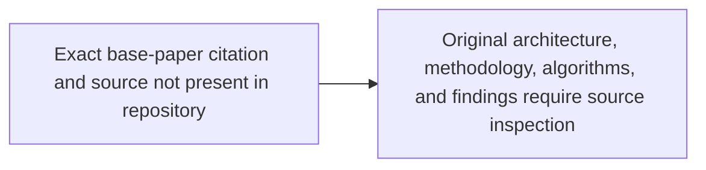
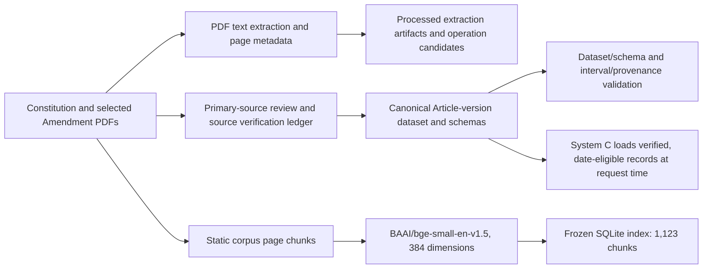
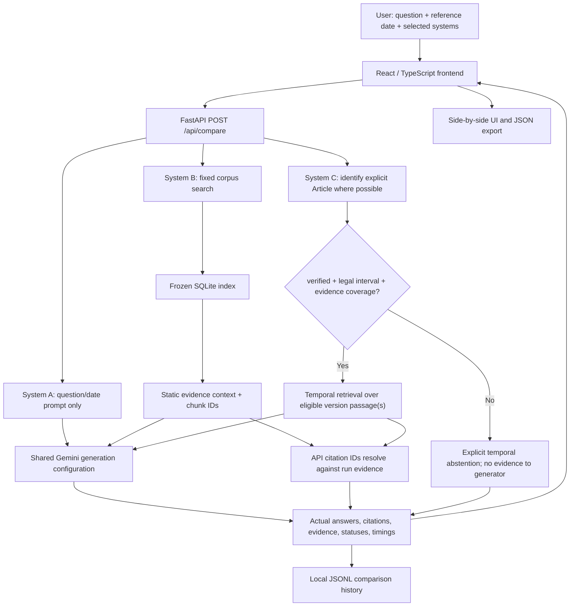

# Temporal-Aware Evidence-Grounded Retrieval for Legal Question Answering

## An Indian Constitution Law Study Comparing a Base LLM, Static RAG, and Temporal RAG

This final-year research and engineering project studies a specific legal QA problem: **the correct constitutional answer may depend on the date in the question**. An LLM or a fixed-corpus retriever can use wording that is accurate today but was not in force at the historical date being asked about.

The repository implements three comparable conditions: **System A, a Base LLM without project-corpus retrieval; System B, Static RAG over a frozen Constitution-and-amendment index; and System C, Temporal RAG that selects verified, date-eligible Article versions before retrieving evidence**. The research contribution is the version and evidence-coverage gate, source-grounded answer path, and explicit abstention when the available verified record cannot support the requested date.

> **Research status:** results are promising on a narrow Article 174 development subset, but the overall evidence is inconclusive. Article 174 is the only provision with verified historical versions in the current canonical pilot. The prospective held-out set is small and is not fully independent or blinded. This README does not claim that the hypothesis has been proven.

## Application Preview

No genuine screenshots are currently checked in. The six exact capture targets and instructions are in [`docs/images/README.md`](docs/images/README.md). Add real screenshots there before uncommenting the references below; do not replace them with mockups.

<!-- Uncomment each line only after its genuine screenshot has been captured and added.


-->

## Contents

- [Research question and scope](#research-question-and-scope)
- [Academic foundation: base research paper](#academic-foundation-base-research-paper)
- [Original base-paper architecture and methodology](#original-base-paper-architecture-and-methodology)
- [Question sources and benchmark construction](#question-sources-and-benchmark-construction)
- [Primary legal sources](#primary-legal-sources)
- [Research gap and contribution](#research-gap-and-contribution)
- [Proposed temporal legal QA architecture](#proposed-temporal-legal-qa-architecture)
- [The three systems](#the-three-systems)
- [Legal-version data model](#legal-version-data-model)
- [Benchmark and experimental design](#benchmark-and-experimental-design)
- [Current results](#current-results)
- [Implementation status](#implementation-status)
- [Application and API](#application-and-api)
- [Technology stack](#technology-stack)
- [Repository map](#repository-map)
- [Installation and local use](#installation-and-local-use)
- [Validation, tests, and reproducibility](#validation-tests-and-reproducibility)
- [Limitations and future work](#limitations-and-future-work)
- [References and source records](#references-and-source-records)

## Research Question and Scope

**Main research question:** Does version-aware temporal retrieval improve temporal validity and citation correctness for date-dependent questions about selected provisions of the Constitution of India compared with a Base LLM and a Static RAG system?

This is a hypothesis to investigate, not a conclusion presumed in advance. The study focuses on selected Articles and amendment histories supported by the repository’s available source evidence. It does not reconstruct the complete amendment history of the Constitution.

### Objectives

1. Implement a parametric Base LLM baseline and two evidence-retrieval conditions.
2. Represent selected constitutional text as versioned legal records with source provenance.
3. Select temporal evidence using legal effective intervals and verification status.
4. Enforce a separate evidence-coverage cutoff so a finite source snapshot is not mistaken for proof of unlimited legal validity.
5. Generate answers grounded in retrieved legal evidence and resolve citations to the evidence actually returned for a run.
6. Abstain when no verified, date-eligible evidence is available.
7. Evaluate the systems using identical question wording and reference dates.

## Academic Foundation: Base Research Paper

**The exact academic base paper is not identifiable from the current repository.** The checked-in files contain no research-paper PDF, bibliography entry, DOI, author/title citation, research proposal, or literature-review document naming the paper. The generic RAG descriptions in the previous README do not establish which paper, if any, was used as the academic foundation.

> **Citation required from the project author:** `[Full title; author(s); year; journal/conference or repository; DOI or official URL]`.

This placeholder is intentional. No generic RAG paper is substituted or attributed to the project. Until the exact reference and source are supplied, this README cannot accurately summarize that paper’s research problem, findings, algorithms, equations, or adopted concepts.

### Original Base-Paper Architecture and Methodology

The original paper’s architecture is **not documented here** because the paper has not been identified. A generic retrieval-and-generation diagram would risk misrepresenting the source. The placeholder below marks the missing source; it is not an architecture claim.



Once the paper is provided, replace this placeholder with a source-checked diagram of the paper’s actual components and data flow. Keep that diagram separate from the implemented project architecture below.

## Question Sources and Benchmark Construction

No separate academic question-source paper or question paper is identified in the repository. The benchmark’s source references point to **constitutional and amendment materials**, not to a second research paper. The question set is therefore described as authored from the legal sources recorded with each benchmark item; no external question paper is claimed.

| Questions | Source basis recorded in the benchmark | Status and use |
|---|---|---|
| Q001–Q007 | Official consolidated Constitution snapshot, mainly direct Article text | Source-backed current-text items. |
| Q008–Q011 | Constitution (Eighty-sixth Amendment) Act, 2002, including its sections | Source-backed Act-text questions. |
| Q012–Q014 | Officially indexed text for Gazette notification S.O. 427(E) | Pending primary-source page verification; no gold answer is scored. Notification date, Gazette publication date, and appointed commencement date remain distinct. |
| Q015–Q018 | Historical Articles 21A and 45 | Pending. Their canonical records remain `partially_verified` and are not temporal gold evidence. |
| Q019–Q020 | Consolidated Constitution snapshot and narrow text comparisons | Development questions. |
| Q021–Q032 | Article 174 original Constitution, First Amendment Act, official consolidated text, and verified canonical Article 174 records | Development and diagnostic extension; Q032 is an evidence-coverage abstention control. |
| Q033–Q042 | The same verified Article 174 primary-source materials and bounded versions | Separate prospective held-out question set; not fully independent or blinded. |

The development dataset `benchmark/questions.json` contains 32 questions: **25 suitable for evaluation preparation and 7 pending source verification**. The 7 pending questions are not treated as successful or scored answers. The separate held-out file contains 10 questions. The project’s original planning goal of approximately 209 questions is a planning target, not a reason to fabricate or weakly source additional items.

Both benchmark files retain a question, ISO reference date, expected answer or explicit pending/abstention state, gold evidence, target Article(s), version expectations where applicable, and source references. All systems are dispatched the same question string and reference date. The held-out runner manifest pins the file hash and static-index snapshot.

See [`benchmark/README.md`](benchmark/README.md), [`benchmark/schema.json`](benchmark/schema.json), [`benchmark/questions.json`](benchmark/questions.json), and [`benchmark/held_out_article174_questions.json`](benchmark/held_out_article174_questions.json).

## Primary Legal Sources

The corpus and Article 174 records use local legal documents with page-level source references where those have been inspected. Primary sources matter here because a fluent model answer is not evidence that a particular wording was in force on a particular date.

| Source | Repository locator and use | Verification boundary |
|---|---|---|
| Constitution of India (1949), image-based scan | Local path when supplied: `raw/sources/Constitution_of_India_English_1949.pdf`. Article 174 is PDF p.106 (1-based), printed p.89; Article 394 is PDF p.250. The Article 174 wording was visually inspected. SHA-256: `9d907654a9f8000c0629000b6011e8b112a2d2b7f599a3130c618235b2b38f007`. | The 1949 scan is excluded from Git because it is larger than GitHub’s regular-file limit. It is not the static index source. Its SHA-256 is recorded with source-verification evidence. |
| Constitution of India, official consolidated edition as on 1 May 2026 | `raw/constitution/Constitution_of_India_2024.pdf` (the filename year is not the edition date). Article 174 and its footnote are on PDF p.111; the preface is on p.2. SHA-256: `4c8e93689ec245e26db08e22b5ff3ad645c98736f0e5b7c8b6638acd7861f85b`. It is also the Constitution component of the static corpus. | Supports the Article 174 annotation and consolidated text as of the stated snapshot; it does not prove legal validity after 1 May 2026. |
| Constitution (First Amendment) Act, 1951 | `raw/amendments/001_Amendment_1951.pdf`, Section 8, PDF p.4. SHA-256: `316dae4a42e11ccab825e47b495a8bf2ff0bebbb8877cfe61ba0756c19d1e9c9`. | Visually inspected wording source for Article 174 substitution. Its printed Act date, assent, Gazette publication, and Article-specific effective date are not interchangeable. |
| Constitution (Eighty-sixth Amendment) Act, 2002 | `raw/amendments/086_Amendment_2002.pdf`; Sections 2 and 3 concern Articles 21A and 45. [Legislative Department copy](https://www.legislative.gov.in/static/uploads/2025/07/16970eb1a68d4fe46ac40acd783a6c34.pdf). | Act text is available. The Act’s printed date is not by itself the appointed commencement date. |
| Gazette notification S.O. 427(E), 16 February 2010 | The repository ledger records [India Code indexed text](https://www.indiacode.nic.in/bitstream/123456789/4322/1/rte_goi_2009.pdf): Gazette of India, Extraordinary, No.591, publication 19 February 2010, notification dated 16 February 2010, appointing 1 April 2010. | This is indexed-text evidence, not a locally inspected Gazette PDF page. Do not claim a local page number, hash, or visual inspection. Related benchmark questions remain pending. |

The original Constitution scan is available through a [Parliament Digital Library record](https://eparlib.sansad.in/handle/123456789/2495437?view_type=browse), as referenced in the canonical source documentation. The repository does not record a verified acquisition URL for the exact 2026 consolidated PDF. Source hashes and locators are retained in [`processed/canonical/source_verification_ledger.json`](processed/canonical/source_verification_ledger.json), [`processed/canonical/README.md`](processed/canonical/README.md), and the relevant benchmark source references.

The local amendment corpus is selected, not exhaustive. The static-index metadata records that some amendment PDFs have no extractable text and were excluded; the pipeline does not OCR those documents. Neither the current static index nor parser-generated amendment operations establish complete amendment history for every Article.

## Research Gap and Contribution

An LLM can answer from learned general knowledge without exposing which historical wording it used. A static retriever can find a relevant passage but still return a current provision for a question about an earlier date. Constitutional amendments make that distinction concrete: an Article may be amended, substituted, inserted, or omitted, and the legal transition date may differ from an Act’s printed date or assent date.

For historical legal QA, semantic relevance is not enough. A system must also establish that the selected legal version:

- belongs to the Article asked about;
- was legally effective on the reference date;
- has a verification status that permits use; and
- is supported by evidence through that date.

The project implements those eligibility checks for a limited canonical dataset, grounds retrieval answers in retrieved passages, resolves citation IDs against per-run evidence, and abstains when the temporal evidence gate fails. This is a research prototype, not a complete legal information service.

### Implemented contributions

- Three-system comparative implementation with shared Gemini model settings.
- Static corpus/index and a separate temporal version corpus/index.
- Half-open effective intervals and an inclusive evidence-coverage cutoff.
- Verified-only version eligibility for System C.
- Citation provenance containing passage, source document, and locator where available.
- Explicit handling of API errors, execution failures, and temporal abstentions.
- JSONL experiment logging, benchmark manifests, a local comparison API, and a React demonstration UI.

The implementation does **not** include exhaustive amendment coverage, adjudicated histories for all constitutional Articles, case-law retrieval, web search, or a fully independent confirmatory benchmark.

## Proposed Temporal Legal QA Architecture

The following diagrams describe the **implemented repository**, not the unidentified academic base paper.

### Data preparation and indexes



The extraction scripts produce useful intermediate data, but the canonical historical dataset is a separately validated evidence object. Parser output alone does not upgrade a legal record’s verification status.

### Request-time application flow



The backend invokes only the systems selected in the request. System A receives no project-corpus context. System B passes the reference date to the generation prompt but never applies it as a retrieval filter. System C filters records **before** retrieval and generation. The UI displays actual returned answers, citations, evidence, version metadata, errors, and abstentions; it does not calculate legal correctness scores.

## The Three Systems

All three conditions share `gemini-3.5-flash-lite` by default and the same configured maximum output length, timeout, and bounded transient retry settings. The model can be overridden with `GEMINI_MODEL_NAME`. For Gemini 3.x, the implementation omits the sampling-temperature field from the SDK request; logs distinguish the configured default from a value actually sent.

| Feature | System A — Base LLM | System B — Static RAG | System C — Temporal RAG |
|---|---|---|---|
| Gemini generation | Yes | Yes | Yes, when eligible evidence exists |
| Project-corpus retrieval | No | Yes | Yes, after temporal eligibility |
| Fixed SQLite index | No | Yes | No; builds a small selected-version index in memory |
| Reference date | Included in prompt | Included in prompt, not a retrieval filter | Used to select legal interval before retrieval |
| Verification-status gate | No | No | Requires exactly `verified` |
| Evidence-coverage gate | No | No | Requires coverage and `reference_date <= verified_through` |
| Evidence citation IDs | None by design | Retrieved static chunk IDs | Version-specific temporal chunk IDs |
| Abstention on missing temporal evidence | Not enforced | May say context is insufficient, but has no temporal gate | Explicit pre-generation abstention; no current-text fallback |

### System A — Base LLM

System A accepts a question and reference date and constructs a neutral Indian constitutional-law prompt. It sends no Constitution pages, amendment documents, project corpus, vector database, search result, or external tool to Gemini. This makes it the parametric-only baseline. Its answer can reflect general model knowledge but cannot be traced to retrieved project evidence, and it is not guaranteed to identify the historical version applicable on the reference date.

### System B — Static RAG

System B indexes extractable text from `raw/constitution/Constitution_of_India_2024.pdf` and selected `raw/amendments/*.pdf` files. The Constitution PDF cover says the edition is as of 1 May 2026. Text is segmented by PDF page and chunked (default target 1,800 characters with 200-character overlap); page, source path, Article metadata where detected, stable chunk ID, and locator are kept with each passage. No OCR is performed on scanned-only amendment files.

The frozen `processed/static_rag/index.sqlite3` contains **1,123 chunks**, uses `BAAI/bge-small-en-v1.5` embeddings (384 dimensions), and exact cosine similarity. A dependency-free BM25-style lexical ranking is fused with dense ranks using weighted Reciprocal Rank Fusion. Explicit Article identifiers, including suffixes such as `21A`, receive Article-aware priority; complete matched Article passages may exceed general `top_k` so a provision is not cut mid-clause. Context blocks are included whole or omitted whole under an approximate 4,000-token budget. These are implementation details of this project, not claims about an academic base paper.

System B does not receive a date argument in its retrieval function. The date is logged and supplied to the answer prompt as context, but the static index is searched without historical filtering. It therefore may retrieve current or amendment discussion passages that mention the Article without proving the wording in force on the date asked.

### System C — Temporal RAG

System C identifies an explicit Article identifier when possible, then loads the canonical dataset and validates it. It excludes records below the `verified` threshold, checks the legal interval `[effective_from, effective_to)`, checks inclusive evidence coverage, and only then creates/searches the temporal index. A candidate outside coverage is excluded even when `effective_to` is `null`. The temporal index uses the same embedding model and lexical/dense retrieval approach; it is built in memory from eligible versions and does not modify the Static RAG index.

The generated context includes temporal citation IDs and the selected record’s provenance. If no verified version covers the date, a provision is not in force, coverage is absent/expired, or evidence is insufficient, System C records an abstention and does not send Article text to Gemini. It never silently falls back to the current Constitution text.

For the current real canonical data, only the two Article 174 records are verified and have evidence coverage. Article 21A and Article 45 records remain `partially_verified` and cannot be retrieved for temporal answer generation.

## Legal-Version Data Model

`processed/canonical/article_version.schema.json` describes a record, and `article_versions_dataset.schema.json` describes the dataset envelope. The validator checks schema requirements plus dates, duplicate IDs, interval consistency, source references, and operation/state relationships.

The record fields include:

- `article_number`, `version_id`, and `text` (nullable for not-in-force/omitted states);
- `effective_from` and `effective_to` (inclusive start, exclusive end; `null` means no recorded legal end);
- `operation_type` (`baseline`, `inserted`, `substituted`, `amended`, `omitted`, etc.) and `provision_status`;
- `source_amendment`, `source_section`, and `source_reference` with document and locator plus commencement/end-boundary evidence where available;
- `verification_status` and `verification_notes`; and
- optional `evidence_coverage`, with inclusive `verified_through` plus source document, locator, and supported claim.

Legal validity and evidence coverage are distinct. An open legal interval does not prove that the provision has been verified indefinitely. System C requires evidence coverage and abstains after its cutoff.

### Verified Article 174 example

| Version | Legal interval | Evidence coverage | Source basis |
|---|---|---|---|
| `174_original_1949` | `[1950-01-26, 1951-06-18)` | Through 1951-06-17 inclusive | 1949 Constitution Article 174, PDF p.106 / printed p.89; Article 394 supports initial commencement; consolidated Article 174 footnote supports the 1951 transition. |
| `174_first_amendment_s8` | `[1951-06-18, null)` | Through 2026-05-01 inclusive | First Amendment Act, Section 8, PDF p.4; official consolidated Article 174 and footnote, PDF p.111, within the 2026-05-01 snapshot. |

The old version is eligible on 17 June 1951 and excluded on the exclusive end date, 18 June. The replacement starts on 18 June. The replacement record has no recorded legal cessation date, but System C must abstain for 2 May 2026 because that is beyond its evidence cutoff. This is not a claim that Article 174 ceased to be law on 1 May.

The other four records—pre/post Article 21A and pre/post Article 45 around the 86th Amendment—remain `partially_verified` and have no evidence coverage. They are not eligible temporal gold evidence. The canonical pilot is not a complete history of all constitutional Articles or amendments. See [`processed/canonical/README.md`](processed/canonical/README.md) and [`processed/canonical/source_verification_ledger.json`](processed/canonical/source_verification_ledger.json).

## Benchmark and Experimental Design

### Question sets

`benchmark/questions.json` is the **development benchmark** (Q001–Q032): 32 total, 25 suitable for evaluation preparation, and 7 pending. Categories are direct Article lookup (11), text-constrained constitutional interpretation (2), amendment-related (4), historical-version (8), effective-date (5), and multi-Article (2). Pending questions remain in the file but are skipped by the runner and excluded from scores.

`benchmark/held_out_article174_questions.json` is a separate **prospective held-out** set (Q033–Q042), with 10 source-backed Article 174 cases. It is prospective because question wording was frozen before this run, but it is **not fully independent or blinded**: Article 174 version construction and boundary testing preceded the authoring of these questions. It must not be described as an external confirmatory set.

The same benchmark record supplies the exact same question and reference date to A, B, and C. The runner creates separate per-system JSONL output, a manifest, a summary, and skipped-question reasons. Live generation requires an explicit `--live` flag.

### Scoring and metrics

The evaluation compares answers with the source-backed expected answer, key facts, and legal evidence. The documented scoring is manual/rule-assisted rather than LLM-as-judge. The metrics have different meanings:

| Metric | Meaning and current status |
|---|---|
| Temporal validity accuracy | Primary research metric: answer applies the legally relevant version/rule on the reference date. Reported for the adjudicated Article 174 development subset. |
| Substantive answer correctness | Requested facts are correct and no material contradiction is added. Reported for the development benchmark and per-question adjudication. |
| Citation support | Whether cited evidence substantively supports the answer claim; separate from whether an ID resolves. System A has no corpus citations by design. |
| Citation precision / citation coverage | Not established as a single comprehensive benchmark metric. Existing reports manually classify B citations and temporal evidence; do not infer broader precision/recall. |
| Retrieval recall@k | Requires a known set of gold passages and per-run retrieved passages. It is not available from the held-out runner export, which omits complete top-k retrieval arrays. |
| Unsupported-claim rate | Not reported as a corpus-wide rate; individual unsupported or misleading claims are discussed in the evaluation reports. |
| Abstention quality | Run-level abstention and answer-content refusal are distinguished. Q032 tests the expected evidence-coverage abstention. |
| Latency | Runner wrapper elapsed time includes retrieval/orchestration and generation; it is not isolated Gemini generation latency. |
| Tokens and API cost | Not reported as measured: token usage/cost are not reliably recorded in the run artifacts. |

For strict accuracy, answer-content abstentions count as not correct. Answered-only accuracy removes answer-content refusals from its denominator; it does not count abstentions as correct. Run-level abstention, answer-content refusal, and API/runner failure are separate states.

## Current Results

All figures below refer to the named saved runs and evaluation artifacts; they are not a claim of general system superiority.

### Development benchmark live run

The full development run was execution `20261031T073135193342Z-58165fa8` (25 eligible questions; seven pending questions skipped per system). The final summary reports 65 completed calls, 10 System C pre-generation run-level abstentions, zero failures, and 21 skipped system-question rows.

| System | Strict correct | Incorrect substantive | Answer-content abstentions | Strict accuracy | Answered-only accuracy |
|---|---:|---:|---:|---:|---:|
| A — Base LLM | 16/25 | 8 | 1 | 64.0% | 16/24 = 66.7% |
| B — Static RAG | 15/25 | 3 | 7 | 60.0% | 15/18 = 83.3% |
| C — Temporal RAG | 9/25 | 2 | 14 | 36.0% | 9/11 = 81.8% |

System C’s 14 answer-content abstentions include 10 run-level abstentions and four generated insufficiency answers. Strict accuracy penalizes all abstentions as not correct. This whole-benchmark score includes Articles without eligible temporal records and should not be read as a standalone measure of temporal version accuracy.

On the date-dependent Article 174 development subset Q021–Q031, the adjudicated report records temporal validity of **A 7/11 (63.6%), B 5/11 (45.5%), and C 11/11 (100%)**; C’s expected-version selection was 11/11 in that development analysis. The report records fully supported citations for B on 3/11 and C on 9/11 in that subset. These are development results for one Article, not independent confirmation.

For the full development run, the existing B citation audit records 18 citation-bearing answers, 14 fully supported, four partially supported, and none wholly unsupported. The separate [`scoring_methodology_note.md`](results/evaluation/scoring_methodology_note.md) flags the Q026 partial-support rationale for re-adjudication; that proposed correction has not been applied to the frozen original score/report. Treat the aggregate as provisional.

### Prospective held-out Article 174 run

The successful live run is execution `20261031T084946583103Z-5efff8b3`, with 10 completed outputs per system, zero failures, zero run-level abstentions, and zero skips. C’s citation IDs map to the expected date-eligible original passage for Q033–Q036 and replacement passage for Q037–Q042. The runner JSONL does not preserve a separate `selected_version_ids` field or full retrieval arrays, so the citations are evidence-to-record mappings, not direct selector telemetry or enough data to compute retrieval recall@k.

System C returned substantive Article claims on Q033–Q039 and insufficient-evidence answers on the cross-version comparison items Q040–Q042. These three answer-content refusals were returned in completed runs. System B also produced insufficient-context answers on Q033–Q036 and Q040–Q042; A returned an uncertainty/non-answer on Q042. Baselines also answered several questions correctly. The comparison items expose a scope limitation: System C retrieves the version eligible for the one reference date, not both the eligible version and a temporally excluded comparator.

The held-out run is a demonstration of outputs, not a formally scored independent test. The detailed per-question observations, citations, and raw-output locations are in [`teacher_demonstration_report.md`](results/evaluation/teacher_demonstration_report.md) and [`updated_research_conclusion.md`](results/evaluation/updated_research_conclusion.md). The development Q032 control separately records C abstaining on 2026-05-02 because verified evidence ends on 2026-05-01; zero run-level abstentions in the held-out run does not mean System C never abstains.

### Timing and usage

For the development run, the saved summary records mean wrapper execution of 5.75 seconds for A, 6.81 seconds for B, and 3.30 seconds for C. C’s average includes pre-generation abstentions, so these means are not direct model-speed comparisons. The logs do not provide reliably measured model token usage or API cost.

## Implementation Status

### Research and legal data

- PDF extraction and intermediate Article/amendment processing scripts are present.
- A fixed source manifest, page-level static chunk metadata, SQLite index, and canonical version schemas/validator are present.
- Two Article 174 versions are verified with bounded evidence coverage.
- Article 21A and Article 45 records remain partially verified; no complete amendment history is claimed.

### Retrieval, generation, and provenance

- Systems A, B, and C use a shared Gemini generation configuration.
- Static hybrid retrieval, verified-only temporal selection, effective intervals, evidence cutoffs, explicit abstention, JSONL logging, and citation resolution are implemented.
- The API/UI show citations and source metadata from actual run evidence. Unavailable fields are presented as unavailable rather than inferred.

### Application

- FastAPI local comparison backend with health, comparison, and history endpoints.
- React, TypeScript, Vite, and Tailwind CSS frontend with date/question input, system selection, side-by-side outputs, evidence details, temporal metadata, local history, and JSON export.

### Tests

The repository’s most recently documented milestone is **95 passing Python tests** and a successful frontend production build. Re-run the commands below in your environment; test results are not a substitute for legal-source verification.

## Application and API

The frontend calls the local FastAPI backend through `/api` (Vite proxies requests to `http://127.0.0.1:8000` by default). The request passes the exact question, reference date, and selected system list. The backend calls existing system entry points and returns actual outputs; it does not return mock answers.

| Method and endpoint | Purpose | Request / response fields |
|---|---|---|
| `GET /api/health` | Reports local backend/system prerequisite availability. It does not call Gemini or download embeddings. | Returns overall status, `all_systems_available`, per-system availability, and whether an API key is configured (never the key value). |
| `POST /api/compare` | Runs only selected systems and saves the comparison to local JSONL history. | Request: `question`, ISO `reference_date`, unique `systems` list from `A`, `B`, `C`. Response includes comparison ID/time, same input question/date, and each system’s answer, status, citations, retrieved/prompt evidence, elapsed time, errors, and abstention reason. System C also returns requested/selected Article information, intervals, verification statuses, and coverage. |
| `GET /api/history?limit=20` | Returns the newest saved local comparison runs. | `limit` is 1–100; response contains `count` and `runs`. |

Interactive API documentation is available at [`http://127.0.0.1:8000/docs`](http://127.0.0.1:8000/docs) after the backend starts. The UI expands citations, displays retrieved passages and provenance, distinguishes errors from abstentions, and exports a comparison as JSON. It does not assign answer correctness scores.

## Technology Stack

| Technology | Role in this repository |
|---|---|
| Python 3.10+ | Experiment systems, data validation, benchmark runner, and API. |
| FastAPI, Pydantic, Uvicorn | Local API and request validation. |
| Google Gen AI SDK (`google-genai`) | Gemini generation for A/B/C with a shared configurable model. |
| `python-dotenv` | Loads the ignored local `.env` without overriding process variables. |
| PyMuPDF | Extracts PDF text and page metadata for corpus/data preparation. |
| FastEmbed + `BAAI/bge-small-en-v1.5` | CPU ONNX embeddings for dense retrieval (384-dimensional vectors). |
| NumPy | Exact cosine similarity and vector operations. |
| SQLite | Persists the fixed Static RAG chunks, vectors, and provenance. |
| React, TypeScript, Vite | Local comparison interface and development server. |
| Tailwind CSS v4, `lucide-react` | Frontend utility styling and interface icons. |
| Python `unittest` | Mocked system, canonical, benchmark, and API tests; no pytest dependency is declared. |

## Repository Map

```text
.
├── benchmark/
│   ├── questions.json                     # Development benchmark Q001–Q032
│   ├── held_out_article174_questions.json # Prospective set Q033–Q042
│   ├── schema.json
│   ├── validate_benchmark.py
│   └── run_benchmark.py                   # Dry-run by default; live needs --live
├── docs/images/                           # Screenshot capture instructions; no screenshots yet
├── frontend/                              # React + TypeScript + Vite + Tailwind UI
├── processed/
│   ├── canonical/                          # Version schemas, records, ledger, validator
│   └── static_rag/index.sqlite3           # Frozen System B index used by default
├── raw/
│   ├── amendments/                         # Selected amendment Act PDFs
│   ├── constitution/                       # 2026-05-01 consolidated Constitution PDF
│   └── sources/                            # Large 1949 scan, locally supplied and Git-ignored
├── results/evaluation/                    # Reports, score files, manifests, teacher review
├── systems/
│   ├── generation_settings.py
│   ├── static_corpus.py / static_index.py
│   ├── system_a.py / system_b.py / system_c.py
│   ├── temporal_corpus.py / temporal_index.py
│   └── README.md
├── tests/                                  # System, benchmark-runner, and API tests
├── webapp/app.py                           # FastAPI application
├── extract_*.py, parse_articles.py          # Data-preparation scripts
├── requirements.txt
└── README.md
```

Other generated extraction files in `processed/` are intermediate data and are not interchangeable with the canonical historical dataset. The default static index is `processed/static_rag/index.sqlite3`; an existing alternate/legacy SQLite file is not the configured default.

## Installation and Local Use (Windows PowerShell)

### Prerequisites

- Python 3.10 or later.
- Node.js 20.19+ or 22.12+ and npm for the frontend.
- Gemini API key for live A/B/C generation.
- The checked-in static index and canonical dataset for the default application path.

### Python environment and API key

From the repository root:

```powershell
py -3.10 -m venv .venv
.\.venv\Scripts\Activate.ps1
python -m pip install --upgrade pip
python -m pip install -r requirements.txt
Copy-Item .env.example .env
notepad .env
```

Set `GEMINI_API_KEY` to your own key in `.env`; never commit or paste the key into a report. `.gitignore` excludes `.env`. The checked-in `.env.example` uses a placeholder only. `GEMINI_MODEL_NAME` defaults to `gemini-3.5-flash-lite`. The shared settings also accept `GENERATION_TEMPERATURE`, `MAX_OUTPUT_TOKENS`, `GEMINI_REQUEST_TIMEOUT_SECONDS`, `GEMINI_MAX_RETRIES`, and `GEMINI_RETRY_BACKOFF_SECONDS`; System B context budget is `SYSTEM_B_MAX_CONTEXT_TOKENS`.

The first System B/C use may require FastEmbed model files to exist in the local cache. The app does not rebuild the SQLite index on startup. **Do not run `build-index` for routine use or when reproducing the frozen-index experiment.**

### Start the backend

In a PowerShell window at the repository root:

```powershell
python -m uvicorn webapp.app:app --host 127.0.0.1 --port 8000
```

Check `http://127.0.0.1:8000/api/health` or open the Swagger UI at `http://127.0.0.1:8000/docs`.

### Start the frontend

In a second PowerShell window:

```powershell
Set-Location frontend
npm ci
Copy-Item .env.example .env.local
npm run dev
```

Open the local URL Vite prints (configured for `http://127.0.0.1:5173`). `VITE_API_BASE_URL=/api` and `VITE_BACKEND_PROXY_TARGET=http://127.0.0.1:8000` are the frontend defaults. The browser never receives the Gemini API key.

### Run one question from the command line

```powershell
# System A: parametric-only baseline
python -m systems.system_a --question-id DEMO174-A --reference-date 1951-02-01 --question "What powers did the Governor have under Article 174?"

# System B: static index; date is not a retrieval filter
python -m systems.system_b ask --question-id DEMO174-B --reference-date 1951-02-01 --question "What powers did the Governor have under Article 174?"

# System C: date-selected verified version; temporal evidence only
python -m systems.system_c ask --question-id DEMO174-C --reference-date 1951-02-01 --question "What powers did the Governor have under Article 174?"
```

System A logs to `results/system_a/runs.jsonl`, B to `results/system_b/runs.jsonl`, and C to `results/system_c/runs.jsonl`. System C may abstain before a model call if the date/version/evidence gate fails.

## Validation, Tests, and Reproducibility

Run local checks from the root. These commands do not make Gemini calls:

```powershell
python processed/canonical/validate_article_versions.py
python -m unittest discover -s processed/canonical -v
python benchmark/validate_benchmark.py
python benchmark/validate_benchmark.py benchmark/held_out_article174_questions.json
python -m unittest discover -s tests -v
```

Build the frontend bundle:

```powershell
Set-Location frontend
npm run build
```

Benchmark execution is **dry-run by default**. Use mocked mode to test orchestration without Gemini:

```powershell
Set-Location ..
python benchmark/run_benchmark.py --dry-run
python benchmark/run_benchmark.py --mocked
```

Live runs require the explicit `--live` option and can incur API usage:

```powershell
# Development benchmark Q001–Q032 (only explicitly suitable questions are run)
python benchmark/run_benchmark.py --live

# Separate prospective Article 174 set; does not read/replace the development file
python benchmark/run_benchmark.py --benchmark benchmark/held_out_article174_questions.json --output-root results/benchmark_runs/held_out_article174 --live
```

Each run saves a manifest, summary, skipped-question list, and separate A/B/C JSONL files. The manifest records benchmark and corpus snapshot hashes and omits secrets. The successful held-out run documented here is execution `20261031T084946583103Z-5efff8b3`; its manifest and outputs are under `results/benchmark_runs/held_out_article174/`. Do not rerun a frozen evaluation merely to reproduce its output; use the existing raw artifacts for the reported run.

### The large original Constitution scan

`raw/sources/Constitution_of_India_English_1949.pdf` is **213,220,509 bytes (about 203.34 MiB)** and is intentionally excluded from GitHub by `.gitignore`. It remains part of the local research workspace and should not be deleted. To reproduce the original Article 174 evidence, obtain the same edition from the [Parliament Digital Library record](https://eparlib.sansad.in/handle/123456789/2495437?view_type=browse), place the matching file at the path above, and verify its bytes before relying on it:

```powershell
Get-FileHash -Algorithm SHA256 raw/sources/Constitution_of_India_English_1949.pdf
```

Expected SHA-256: `9d907654a9f8000c0629000b6011e8b112a2d2b7f599a3130c618235b2b38f007`. If the official download differs byte-for-byte and yields another hash, do not call it the same archived source without reviewing the provenance; retain the local original and ask the project maintainer for the exact file/source record.

## Limitations and Future Work

- **Academic citation gap:** the exact base paper and its original architecture are absent. The paper title, authors, publication details, DOI/URL, and any claimed adopted methodology need author confirmation.
- **Narrow legal scope:** only Article 174 has two verified historical records. Four Article 21A/45 records remain partially verified and excluded by System C.
- **Incomplete amendment coverage:** the repository contains selected amendment Acts, not a complete audited amendment sequence for every Article. Some PDFs have no extractable text and are excluded without OCR.
- **Finite evidence endpoint:** Article 174 replacement evidence ends at 2026-05-01. This is an evidence cutoff, not a legal cessation date.
- **Static retrieval is not historical retrieval:** System B searches the fixed snapshot and can retrieve current or incidental text for old-date questions.
- **Question and held-out limitations:** Q001–Q032 are development/diagnostic items; Q033–Q042 is prospective but not fully independent/blinded and all questions concern one Article and transition.
- **Cross-version comparisons:** current System C retrieves only the version eligible on the supplied date. Q040–Q042 require both old and replacement text and are diagnostic limitations under this condition.
- **Extraction and citation limits:** extraction may contain page-order, OCR/text-layer, or glyph issues. B citations can resolve to real chunks without supporting the historical claim. Held-out runner artifacts omit full top-k arrays and separate selected-version telemetry.
- **Evaluation scope:** the held-out run has not been assigned a formal accuracy score file. Whole-development accuracy mixes current-text items and temporal abstentions; do not use it alone to claim a temporal benefit.
- **No legal advice:** the system is a research prototype. A generated answer is not a substitute for checking the cited authoritative source or obtaining legal advice.

Future work should first identify and cite the base research paper, obtain teacher review, independently verify more Article histories and their dates, improve run records to preserve retrieval/selector telemetry, and prospectively evaluate a broader set without changing the approved three-system comparison. New legal text and dates should be added only with source evidence.

## References and Source Records

### Academic papers

- **Base research paper:** **not identified in the repository**. Add the verified full citation and DOI/official URL here after the project author supplies it. No substitute paper is claimed.
- **Question-source paper:** no separate question-source paper was found. Benchmark source references point to primary constitutional and amendment documents as summarized above.

### Legal materials and research records

- Constitution of India (1949), image-based scan; Parliament Digital Library record linked above. Article 174: PDF p.106, printed p.89; exact local file hash is recorded in the canonical source ledger.
- Constitution (First Amendment) Act, 1951, Section 8; local PDF `raw/amendments/001_Amendment_1951.pdf`, p.4.
- Constitution of India, official consolidated edition as on 1 May 2026; local PDF `raw/constitution/Constitution_of_India_2024.pdf`, Article 174 p.111 and preface p.2.
- Constitution (Eighty-sixth Amendment) Act, 2002; local PDF `raw/amendments/086_Amendment_2002.pdf` and the [Legislative Department publication](https://www.legislative.gov.in/static/uploads/2025/07/16970eb1a68d4fe46ac40acd783a6c34.pdf).
- Gazette S.O. 427(E) indexed text at [India Code](https://www.indiacode.nic.in/bitstream/123456789/4322/1/rte_goi_2009.pdf); see the verification limitation above.

### Research and evaluation documents

- [Benchmark README](benchmark/README.md)
- [Canonical version model and sources](processed/canonical/README.md)
- [Source verification ledger](processed/canonical/source_verification_ledger.json)
- [Article 174 source verification note](results/evaluation/article_174_timeline_verification.md)
- [Article 174 temporal comparison](results/evaluation/article174_temporal_comparison.md)
- [Scoring methodology note](results/evaluation/scoring_methodology_note.md)
- [Final live evaluation](results/evaluation/final_live_evaluation.md)
- [Prospective held-out teacher demonstration](results/evaluation/teacher_demonstration_report.md)
- [Teacher review sheet](results/evaluation/teacher_review_sheet.md)
- [Citation provenance audit](results/evaluation/citation_provenance_audit.md)
- [Updated research conclusion](results/evaluation/updated_research_conclusion.md)

---

**Reproducibility note:** preserve benchmark bytes, canonical records, static-index snapshot, raw run JSONL, manifests, and scoring notes together. A successful API execution means the software returned an output; it does not by itself establish legal correctness, citation support, or the research hypothesis.
